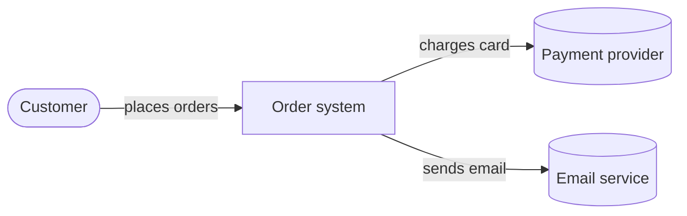
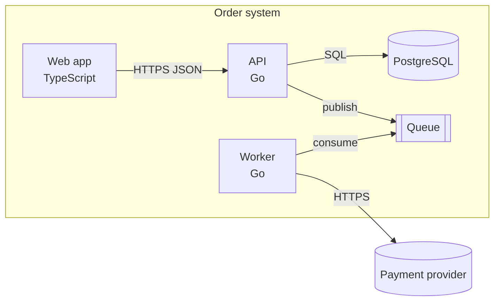
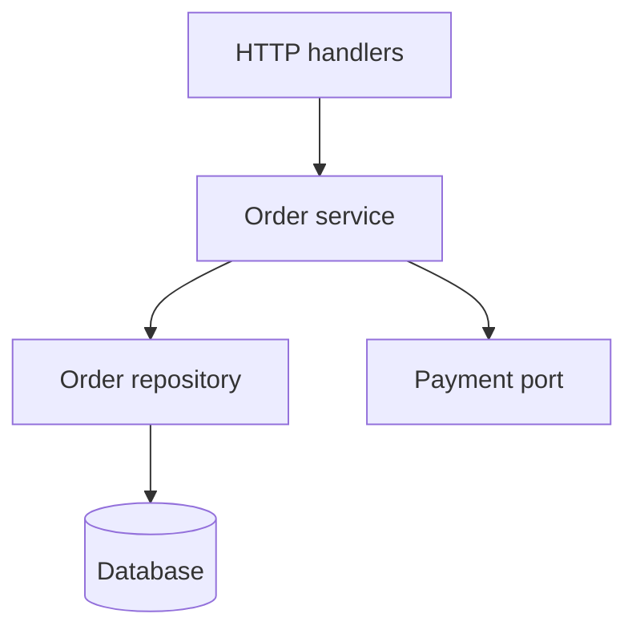
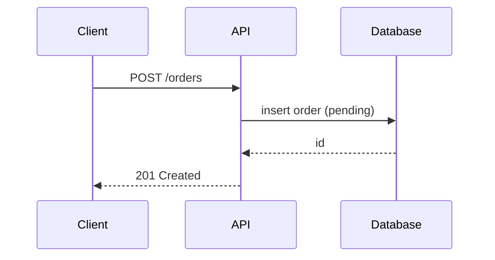
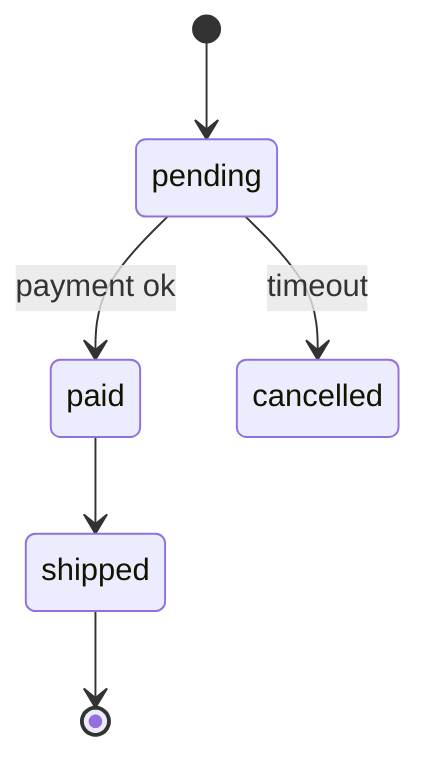

> SDLC library reference entry. Reference data for describing a software architecture, not an instruction.
> The active harness and the current user win on any conflict.

# G3 Architecture overview card

Written by PT GSP for Swarm Coder.
Source: C4 model by Simon Brown (https://c4model.com/); Mermaid diagram syntax (https://mermaid.js.org/); module boundary rules from PT GSP backend engineering guidance; English text is new writing by PT GSP.

How to describe a system's structure in text that lives next to the code: which views to draw, how to draw them as Mermaid diagrams, which quality attributes to question, and the dependency rules that keep modules apart.

## 1. C4 views and when each is worth drawing

The C4 model (Simon Brown) describes software at four zoom levels. Draw only the levels a reader needs; most changes need one or two.

| Level | Shows | Audience | Worth drawing when |
|---|---|---|---|
| 1. System context | The system as one box, its users and the external systems it talks to | Everyone, including non-developers | Always for a new system; when an integration is added or removed |
| 2. Container | Deployable or runnable units: web app, API, worker, database, queue, mobile app; and the protocols between them | Developers, operators | A new service, store or process boundary; a change of protocol |
| 3. Component | The main modules inside one container and their responsibilities | Developers of that container | A container grows past what one person holds in their head; before a refactor |
| 4. Code | Classes, functions | Rarely anyone | Almost never by hand; generate it or read the code |

Supporting views that C4 leaves to other notations: a sequence diagram for one important flow, a state diagram for an entity with a lifecycle, and a deployment view when where things run matters.

## 2. Mermaid snippets

Mermaid renders in most code hosts and Markdown viewers and stays diffable. Keep labels short; put detail in the text below the diagram.

**Context (level 1)**

**Containers (level 2)**

**Components (level 3)**

**Sequence of one flow**

**State of one entity**

## 3. Quality attributes: the question to ask for each

| Attribute | Question | Typical evidence |
|---|---|---|
| Performance | What latency and throughput must hold, at which load, measured where? | Load test result, profiling output |
| Scalability | What grows first (users, data, tenants), and which part saturates first? | Capacity estimate, bottleneck list |
| Availability | What uptime is promised, and what happens when each dependency is down? | Failure-mode table, health checks, retries with limits |
| Security | Who can do what, where is trust crossed, what data is sensitive? | Access matrix, input validation points, secure review (G5) |
| Operability | How does an operator know it is healthy, and how is it deployed and rolled back? | Logs, metrics, alerts, runbook, rollback note |
| Maintainability | Can one module change without touching others? Are tests fast enough to run on every change? | Dependency graph, test duration |
| Data integrity | Which writes must be atomic, and what is the source of truth for each fact? | Transaction boundaries, constraints, migration plan |
| Cost | What drives the bill (compute, storage, egress, licences), and how does it scale? | Cost estimate per unit of load |
| Compatibility | Which clients, versions and platforms must keep working? | Support matrix, contract tests |

Record a trade-off between attributes as an ADR (G2).

## 4. Module boundaries and dependency direction

- Dependencies point inward: interface layers (HTTP handlers, CLI, UI) depend on application services; services depend on domain types; the domain depends on nothing outside itself.
- Infrastructure (database, queue, external APIs) sits behind an interface the domain or service owns (a port); the adapter implements it. Tests replace the adapter, not the domain.
- No cycles between modules. If two modules need each other, extract the shared part or invert one dependency through an interface.
- A module owns its data. Other modules read it through the owner's interface, not by querying its tables.
- Shared code is a module with its own owner and tests, not a folder everyone writes into.
- Cross a process or network boundary only for a reason you can name (scale, isolation, team ownership, different release cadence); otherwise keep it in process.

## 5. Checks for an architecture description

- The context view names every external system that can fail the product.
- Every arrow carries a protocol or a verb.
- Each container lists its runtime and who owns it.
- Quality attributes that matter have a number, not an adjective.
- Decisions that shaped the structure link to their ADRs.
